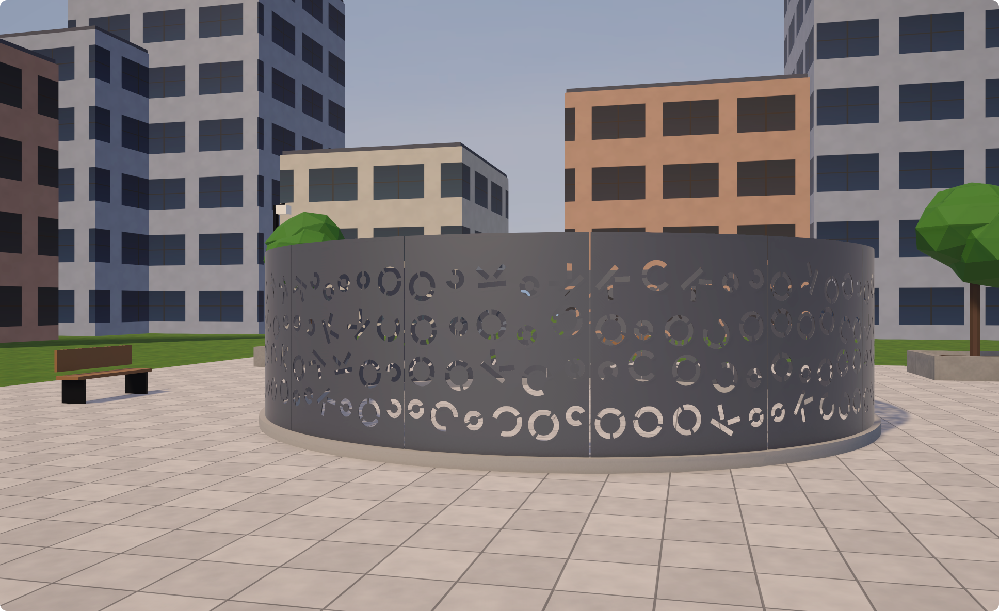

# OKC Ring

The ring in downtown OKC... You know the one.



A PowerWash Simulator 2 mod that brings the perforated steel ring around the transformer at NW 4th & Robinson,
Oklahoma City (the one stencilled with O, K and C) into the game as something to wash.

- **OKC Transformer Screen**: a new career job on its own downtown plaza. 14 panels and the curb, under layered
  grime, mud splats and rust. Finish it and it unlocks in Free Play.
- **OKC Screen on Equinox Boulevard**: a second job that puts the ring on the game's own Streetcar street, in place
  of the tram. The vanilla Streetcar job is untouched.

## Requirements

- PowerWash Simulator 2 **v1.3.1** on Steam. Packs built for another game version are skipped (see Troubleshooting).
- [MelonLoader](https://github.com/LavaGang/MelonLoader) **0.7.x** installed into the game.

## Install

1. Install MelonLoader into PowerWash Simulator 2 and start the game once, so it generates its files.
2. Download `OKC-Ring-v0.1.0.zip` from [Releases](../../releases).
3. Extract it into the game folder (Steam: right-click the game → Manage → Browse local files). You should end up with:

   ```
   PowerWash Simulator 2/
     Mods/
       PWS2LevelLoader.dll
       PWS2LevelLoader/packs/OKC_TransformerScreen/
       PWS2LevelLoader/packs/OKC_Streetcar/
   ```

4. Start the game. Both jobs appear in the career job list, from the customer "Downtown Utilities".

## Uninstall

Delete `Mods/PWS2LevelLoader.dll` and the `Mods/PWS2LevelLoader/` folder. Your save keeps the rest of your
progress.

## Troubleshooting

The log is `MelonLoader/Latest.log` in the game folder. Lines from this mod start with `[PWS2_Level_Loader]`.

- **The jobs don't show up.** Look for `Skipping pack ... built for game X, running Y`: the game has updated
  since the packs were built. Wait for an updated release, or set `IgnoreGameVersion = true` under
  `[PWS2LevelLoader]` in `UserData/MelonPreferences.cfg` at your own risk.
- **"An error occurred when loading".** The log has a `[state]` line with the real exception. Please open an issue
  with your `Latest.log` attached.
- **The game crashes when you quit.** That is MelonLoader's console, not this mod: set `hide_console = true` in
  `UserData/Loader.cfg`.

## Status

Version 0.1.0, tested on game v1.3.1 with automated runs: every panel loads with its dirt, washes to clean,
completes the job and unlocks Free Play, and progress survives a relaunch. Hands-on washing with starter gear
hasn't been played through end to end yet, so feedback on difficulty is welcome. Single player only.

## Building from source

Three parts, each with its own toolchain:

| Folder | Toolchain | Role |
| --- | --- | --- |
| `OKC_TransformerScreen/` | Blender 5.1, Python | Generates the ring and plaza meshes and their dirt masks |
| `PWS2LevelKit/` | Unity 6000.0.73f1 (URP, Addressables) | Authors the levels against stub game types and builds the content packs |
| `PWS2LevelLoader/` | .NET 8 SDK | The MelonLoader mod that registers the packs with the game's campaign |

Build steps, debug keys and automation: [docs/development.md](docs/development.md). How the game defines a level
(hashing, content packs, wash targets, control maps): [docs/phase0-findings.md](docs/phase0-findings.md).

## Credits

- The real ring belongs to Oklahoma City; this is a fan-made, simplified model of it.
- PowerWash Simulator 2 is by FuturLab. This mod is unofficial and not affiliated with or endorsed by FuturLab.
  The stub types in `PWS2LevelKit/Assets/Stubs/` mirror the game's serialized field layout so Unity can build
  compatible packs; they contain no game code.
- Built on [MelonLoader](https://github.com/LavaGang/MelonLoader) and [HarmonyX](https://github.com/BepInEx/HarmonyX).
- Made with help from Claude Code (Anthropic's Claude), which wrote much of the code, the Blender scripts and
  the docs alongside the author.

## License

[MIT](LICENSE).
